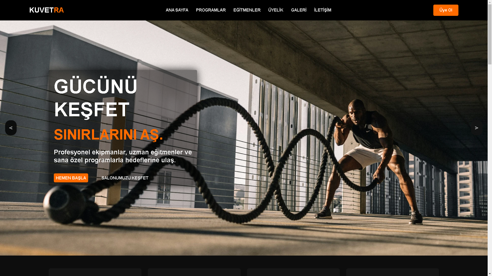
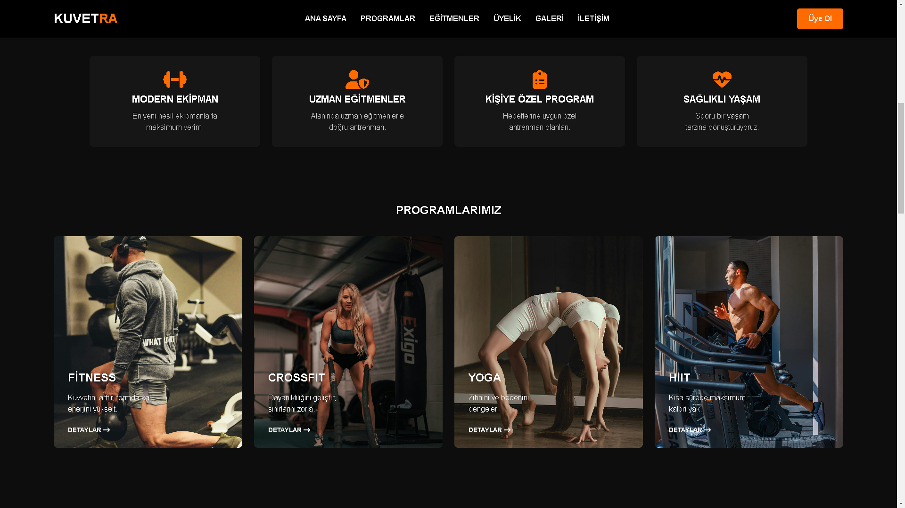
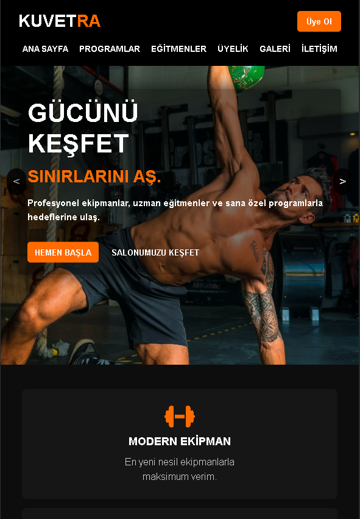

# KUVETRA – Spor Salonu Web Sitesi

HTML5, CSS3 ve JavaScript kullanılarak geliştirilen modern, responsive spor salonu web sitesi.

## Proje Hakkında

Kuvetra, modern bir spor salonu web sitesi tasarımı sunmak amacıyla geliştirilmiş bir front-end projesidir. Kullanıcı deneyimi, görsel tasarım ve farklı ekran boyutlarına uyumluluk ön planda tutularak hazırlanmıştır.

## Ekran Görüntüleri

### Ana Sayfa

### Web Sitesinin Diğer Bölümleri

### Mobil Görünüm

## Kullanılan Teknolojiler

- HTML5
- CSS3
- JavaScript

## Özellikler

- Modern ve kullanıcı dostu arayüz
- Responsive (duyarlı) tasarım
- Farklı ekran boyutlarına uyumlu sayfa düzeni
- Fitness temalı görsel tasarım

## Projeyi Çalıştırma

1. Repository'yi bilgisayarına indir.
2. Proje klasörünü aç.
3. `index.html` dosyasını tarayıcıda çalıştır.

## Geliştirme Amacı

Bu proje, front-end web geliştirme becerilerini uygulamak ve geliştirmek amacıyla hazırlanmış bir portföy çalışmasıdır.
